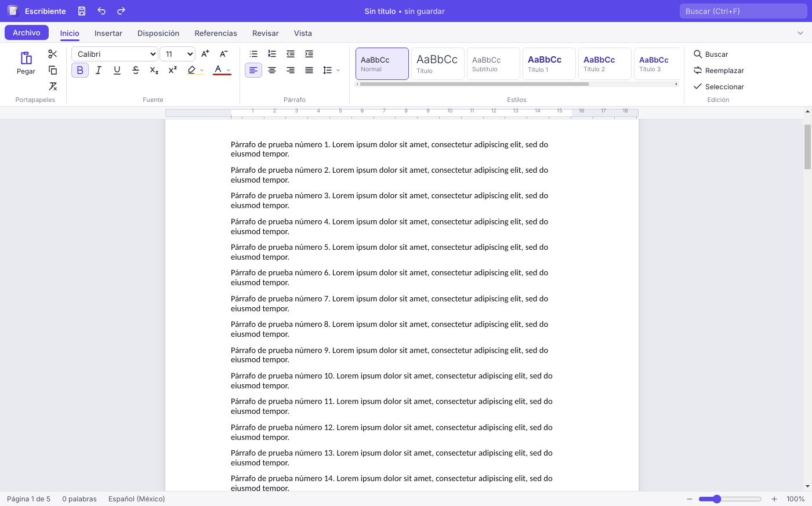
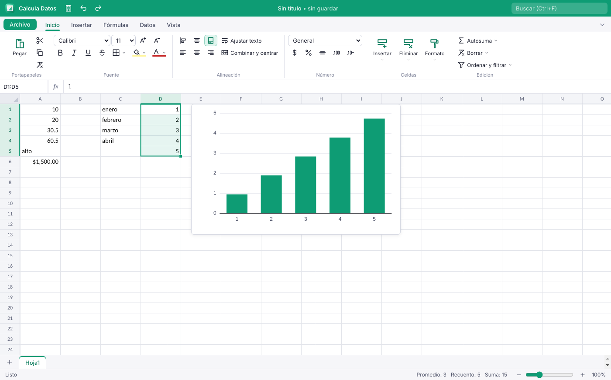
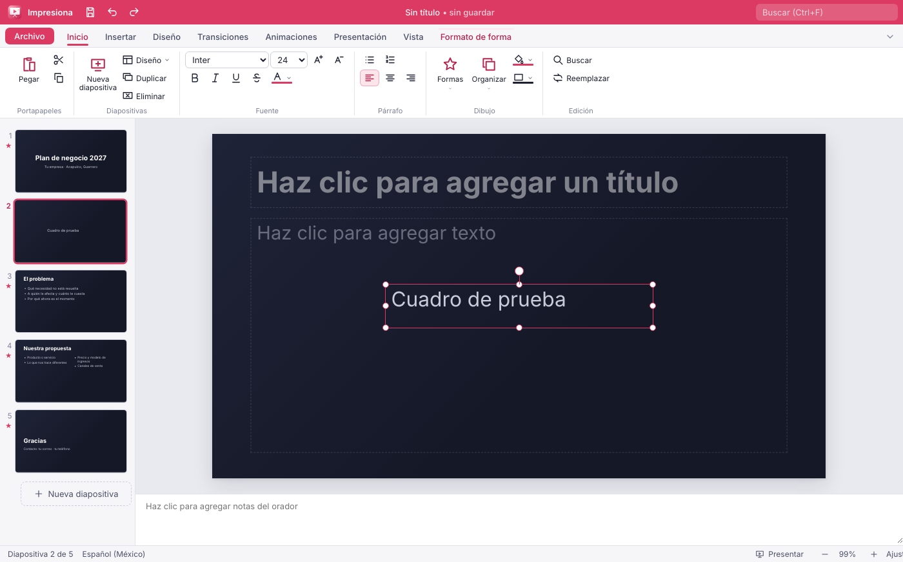

<p align="center"></p>

# Mi Oficina MX

Suite ofimática **libre, gratuita y de código abierto** (GPL-3.0) para **Windows, macOS y Linux**.
Abre y guarda documentos de Word, Excel y PowerPoint (`.docx`, `.xlsx`, `.pptx`), exporta a PDF y funciona sin conexión.

**Sin anuncios, sin cuentas, sin telemetría, sin límites.**

Desarrollado por Santiago Miguel · 744 354 8848 · chago2850@gmail.com

| | App | Para qué sirve | Formatos |
| --- | --- | --- | --- |
|  | **Escribiente** | Procesador de textos: cartas, reportes, currículum | `.docx` (abrir y guardar), `.txt`, `.html`, `.md`, PDF |
|  | **Calcula Datos** | Hoja de cálculo con fórmulas en español | `.xlsx` (abrir y guardar), `.csv`, PDF |
|  | **Impresiona** | Presentaciones con temas, transiciones y animaciones | `.pptx` (abrir y guardar), PDF |
|  | **PapelPDF** | Editor de PDF: anotar, firmar, formularios, OCR | `.pdf` |

## El Launcher

Al abrir Mi Oficina MX aparece una **dona**. Pulsa **Inicio**: se enciende y se divide en cuatro partes, una por app.
Al abrir una app la dona se minimiza, y cuando cierras la última app vuelve a aparecer.

<p align="center"></p>

Atajos de la dona: **1–4** abren cada app, las **flechas** recorren los sectores, **Esc** la cierra. Arrastra la barra "Mi Oficina MX" para moverla.

## Capturas





## Funciones (versión 0.5)

**Común a las tres apps:** cinta con pestañas, inicio con plantillas y recientes, guardar / guardar como, exportar a PDF, imprimir, deshacer y rehacer, buscar y reemplazar, arrastrar y soltar archivos, **recuperación automática** si la app se cierra sin guardar, revisión ortográfica en español e inglés, y el botón para volver a la dona.

**Nuevo en la 0.2 para toda la suite:** abrir y guardar **ODF** (`.odt`, `.ods`, `.odp`), **modo oscuro** (sigue al sistema o se elige), **Preferencias** (idioma, nombre del autor, tema e intervalo de autoguardado) y **Propiedades del documento** (título, autor, asunto, palabras clave).

**Interfaz en español e inglés (0.2.1):** el idioma se elige en *Preferencias* (en la dona) o en *Archivo → Opciones*, y cambia al momento, sin reiniciar: cinta, menús, diálogos, avisos, plantillas nuevas y PapelPDF. Con *Igual que el sistema* se usa español si el sistema está en español y si no, inglés. En inglés, Calcula Datos muestra las fórmulas con los nombres en inglés (`=SUM()`, `=IF()`), como Excel en inglés; el archivo guardado es el mismo en ambos idiomas.

**Nuevo en la 0.3 para toda la suite:** **cifrar con contraseña** (`.docx`, `.xlsx` y `.pptx` con el cifrado estándar de Office, AES-256; también abre los archivos cifrados por Office) y **barra de acceso rápido** personalizable en cada app.

**Nuevo en la 0.4 para toda la suite:** **accesibilidad** (lector de pantalla y teclado: flechas para moverse por la cinta, **F6** para pasar entre la cinta, el documento y la barra de estado, foco visible, el foco no se escapa de los diálogos y Calcula Datos anuncia la celda activa; contraste AA revisado con axe-core), **revisión ortográfica sin internet** (los diccionarios vienen en el instalador) y archivos grandes más rápidos (un CSV de 100 000 filas abre en unos 2 s; un documento de 300 páginas, en menos de 1 s).

**Escribiente**
- Páginas reales (Carta, Oficio México, Legal, A4, A5), orientación y márgenes; la vista en pantalla y el PDF tienen las mismas páginas
- Fuentes, tamaño, negrita, cursiva, subrayado, tachado, sub/superíndice, color y resaltado
- Estilos (Título, Subtítulo, Título 1–4, Cita), alineación, interlineado, sangrías, viñetas y numeración
- Tablas (insertar/eliminar filas y columnas, sombreado), imágenes con cambio de tamaño, vínculos, saltos de página, símbolos
- Encabezado, pie y números de página; índice automático; contador de palabras
- Plantillas: carta formal, reporte y currículum
- **0.2:** comentarios con respuestas, **control de cambios** (aceptar/rechazar), **notas al pie y al final**, **tabulaciones** (izquierda, centro, derecha) en la regla, columnas, cuadros de texto y formas, marca de agua y color de página, panel de navegación por títulos, brocha para copiar formato, sangrías arrastrables en la regla y **combinar correspondencia** desde CSV o XLSX. Todo se guarda en el `.docx` de forma que Word lo entiende
- **0.3:** **ecuaciones** (escritas en LaTeX con vista previa; en el `.docx` quedan como ecuaciones de Word y en el `.odt` como fórmulas), **citas y bibliografía** (APA), **comparar documentos** (el resultado queda como control de cambios), **etiquetas y sobres** (también con los destinatarios de la combinación), **diagramas** tipo SmartArt (lista, proceso, ciclo, jerarquía y pirámide), **modo lectura** y **modo enfoque**, reacciones en comentarios, exportar a **Markdown** y abrir documentos `.doc` de Word 97-2003
- **0.5 — Escribiente como LibreOffice Writer, parte 1 (abrir y guardar sin perder formato):** lector propio de `.docx` y `.odt` que conserva estilos, fuentes, tamaños, colores, resaltado, espaciado antes y después, interlineado (múltiple, mínimo y exacto), sangrías, bordes y sombreado de párrafo, versalitas, mayúsculas, texto oculto, doble tachado, espaciado entre letras, listas con su numeración, tablas con celdas combinadas, anchos, bordes y fondos, imágenes, encabezado y pie con número de página, saltos y notas. Nuevos cuadros **Formato → Párrafo** (sangrías y espaciado, flujo del texto —conservar con el siguiente, no dividir, salto de página antes, viudas y huérfanas—, bordes y sombreado) y **Fuente** (efectos tipográficos, posición y espaciado, escala), **Cambiar mayúsculas y minúsculas** (Mayús+F3) y **Marcas de formato ¶** (Ctrl+F10). Todo se guarda en `.docx` y `.odt` y se comprueba en las pruebas abriéndolo también con LibreOffice
- **0.5.1 — tabulaciones como en Writer:** la tecla **Tab** inserta la tabulación donde está el cursor y avanza a la siguiente parada; la regla muestra las paradas predeterminadas (cada 1.25 cm) y las propias del párrafo: clic en la regla para poner una (izquierda, centrada, derecha o **decimal**, según el botón de la esquina), arrastrar para moverla, arrastrarla fuera para quitarla y doble clic para **Formato → Tabulaciones…** (posición, tipo, **carácter de relleno** ……, y el intervalo de las paradas predeterminadas). Todo se guarda y se lee en `.docx` y `.odt`
- **0.6 — Escribiente como LibreOffice Writer, parte 2 (estilos y listas):** **panel de estilos** (Ctrl+F11) con estilos de párrafo y de carácter, buscar, doble clic para aplicar; **nuevo estilo a partir de la selección**, **actualizar con la selección**, **modificar** (organizador con herencia y estilo siguiente, fuente, sangrías y espaciado, bordes) y eliminar. Al cambiar un estilo cambian todos los párrafos que lo usan, y después de un título, Intro continúa con el estilo siguiente. **Listas multinivel** (1. / a. / i., 1. / 1.1. / 1.1.1., I. / A. / 1.) y viñetas (◦ ▪ ✓ ➢ –) desde la flecha de los botones de lista, con **reiniciar**, **continuar** y **establecer el valor** de la numeración; **numeración de capítulos** para los títulos (1, 1., I. / A. / 1., Capítulo 1). Todo se guarda y se lee en `.docx` y `.odt`, y se comprueba que sobrevive al pasar por LibreOffice
- **0.7 — Escribiente como LibreOffice Writer, parte 3 (tablas):** **seleccionar celdas** arrastrando (o Mayús+clic), **combinar** y **dividir celdas** en filas o columnas, **dividir tabla**; insertar y eliminar filas y columnas respetando las celdas combinadas; **ancho de columna arrastrando el borde**, distribuir filas/columnas y ancho óptimo; alineación vertical; **estilos de tabla** (rejilla, encabezado azul/verde/naranja/gris, elegante, filas alternas) y bordes por disposición; cuadro **Propiedades de tabla** (tabla, columnas, fila, celda, bordes); **ordenar** (numérico o alfanumérico, dos claves); **fórmulas** en celdas (`=SUM(ABOVE)`, `=B2*C2`, AVERAGE, MIN, MAX…) que se recalculan solas; **convertir texto ↔ tabla**. Las tablas largas se **parten por filas entre páginas y repiten la fila de encabezado**. Todo se guarda en `.docx` y `.odt` y sobrevive al pasar por LibreOffice
- **0.8 — Calcula Datos como LibreOffice Calc, parte 1:** cuadro **Formato de celdas** completo (Ctrl+1) con pestañas Números (categorías y opciones: decimales, ceros a la izquierda, separador de miles, negativos en rojo, código de formato con vista previa), Fuente, Alineación (**sangría**, **texto girado** o apilado, ajustar y **reducir para ajustar**, justificado y rellenado), **Bordes con estilo** (fino, medio, grueso, discontinuo, punteado, doble) por disposición, Fondo y Protección (bloqueada, **ocultar fórmula**); **pegado especial** (Ctrl+Mayús+V: valores, fórmulas, formatos, operaciones, omitir vacías, **transponer**); **texto en columnas**; **insertar y eliminar celdas desplazando** (Ctrl++ / Ctrl+-); **mostrar fórmulas** (Ctrl+`); **color de pestaña**; **hipervínculos** (Ctrl+K, Ctrl+clic para abrir); **rastrear precedentes y dependientes** con flechas; **subtotales**; **filtro estándar** con dos condiciones; **autocompletar** al escribir. Todo se guarda en `.xlsx` y `.ods` y sobrevive al pasar por LibreOffice
- **0.9 — Impresiona como LibreOffice Impress, parte 1:** cuadro **Posición y tamaño** (F4: posición, tamaño con proporción, giro, voltear, proteger); **Línea** (continua, guiones, puntos, grosor, transparencia, **puntas de flecha**); **Área** (color, **degradado** lineal o radial, **transparencia**, **sombra**); **Texto** (márgenes, anclaje, reducir al desbordar, columnas, interlineado y espacio entre párrafos); **20 formas nuevas** (rombo, hexágono, corazón, nube, globo de diálogo, flechas, cheurón…); **voltear y girar 90°**, **distribuir**, alinear a la selección, **traer adelante / enviar atrás un nivel**, **agrupar** (Ctrl+Mayús+G); **recortar imágenes** y ajustes (brillo, contraste, escala de grises, sepia, transparencia, tamaño original); **acción al hacer clic** (Ctrl+K: web, ir a diapositiva, siguiente, anterior, terminar); **ocultar diapositiva**; **cuadrícula** visible y con ajuste; **clonar formato**. Se guarda en `.pptx` y `.odp` (con copia exacta para Impresiona dentro del .odp) y sobrevive al pasar por LibreOffice
- **0.10 — Escribiente como LibreOffice Writer, parte 4 (Insertar):** **campos** (fecha y hora con formato, número de página, total de páginas, título, autor, nombre de archivo, recuento de palabras) que se actualizan solos; **marcadores**; **referencias cruzadas** a encabezados, marcadores y títulos (texto, página, «Figura 2», número, arriba/abajo); **títulos de objetos** (Figura 1, Tabla 1… con numeración automática); **índice de ilustraciones / de tablas**; **índice alfabético** con entradas marcadas; **salto de columna** (Ctrl+Mayús+Enter); **Actualizar todo** (F9). Las secciones en columnas ahora se guardan también en `.odt` y se leen de `.docx`. Todo se guarda como campos reales de Word y de LibreOffice
- **0.11 — Escribiente como LibreOffice Writer, parte 5 (Página):** encabezado y pie con **primera página distinta** y **páginas pares e impares distintas**, en **tres partes** (izquierda, centro y derecha separadas por tabulación), con campos ({pagina}, {paginas}, {fecha}, {titulo}, {autor}, {archivo}), formato (tamaño, negrita, cursiva, color, alineación, línea separadora) y **primer número de página**; **borde de página** (sólido, doble, discontinuo, punteado, color, distancia, sombra); **numeración de líneas** (cada N líneas, continua o por página). Se guarda en `.docx` y `.odt` y sobrevive al pasar por LibreOffice
- **0.12 — Escribiente como LibreOffice Writer, parte 6 (Herramientas):** **buscar y reemplazar** con **expresiones regulares** ($1, $2…), **palabras completas**, por **estilo de párrafo** y **solo en la selección**; **autocorrección** al escribir (tabla de reemplazo editable, mayúscula al empezar oración, DOs MAyúsculas, comillas tipográficas, guiones, \*negrita\* /cursiva/ \_subrayado\_, vínculos web); **sinónimos** sin internet (Ctrl+F7, diccionario de RLA-ES); **separación silábica** con los patrones del español; **ordenar párrafos**
- **0.13 — Escribiente como LibreOffice Writer, parte 7 (Archivo):** cuadro **Imprimir** con vista previa, impresora, copias, intervalo de páginas, páginas por hoja, escala de grises y doble cara; **vista previa de impresión** (Ctrl+Mayús+O); **Opciones de PDF** (intervalo, títulos como marcadores, PDF etiquetado, vista inicial, marca de agua, contraseña y permisos); abrir y guardar **RTF**; exportar como **libro electrónico EPUB**; **texto codificado** (UTF-8, Windows-1252, UTF-16 y fin de línea); **propiedades del documento** con comentarios, categoría y propiedades personalizadas. Imprimir, la vista previa, las opciones de PDF y las propiedades también llegan a Calcula Datos e Impresiona
- **0.13 — Calcula Datos como LibreOffice Calc, parte 2:** **Ordenar…** con tres criterios, orden natural, de izquierda a derecha y copiar el resultado; **Rellenar** abajo, derecha, arriba e izquierda; **Rellenar serie** (lineal, crecimiento, fechas por día, día laborable, mes o año, y autorrelleno de días, meses y textos con número); **números aleatorios** (uniforme, entera, normal, Bernoulli, binomial, Poisson, con semilla); **Estadísticas** con fórmulas vivas (descriptiva, correlación, covarianza, media móvil, suavizado exponencial, muestreo y regresión lineal); funciones nuevas CURTOSIS, MODA, INTERSECCION.EJE y PRONOSTICO; **Consolidar** por etiquetas; **Gestionar duplicados**; **estilos de celda** (Bueno, Neutral, Malo, Encabezado, Nota…); MAYÚSCULAS, minúsculas y Tipo Título; **mover, copiar, ocultar y mostrar hojas** (se guardan en .xlsx y .ods)
- **0.13 — Impresiona como LibreOffice Impress, parte 2:** **presentaciones personalizadas** (elegir y ordenar diapositivas); **Configurar la presentación** (intervalo, presentación personalizada, en bucle con pausa como quiosco, avance manual, pluma o láser al empezar), que se guarda también para PowerPoint y LibreOffice; vista **Esquema** para escribir títulos y puntos; **Diapositiva de resumen** y **Expandir diapositiva**; **insertar diapositivas desde otro archivo**; **Duplicar** con desplazamiento, giro, tamaño y colores (Mayús+F3); **campos** en el texto (fecha, hora, número, total, título, archivo, autor); **imprimir o exportar a PDF** diapositivas, **notas**, **documento** (folletos de 1, 2, 3 con líneas, 4, 6 o 9 por página) o **esquema**
- **0.14 — Calcula Datos, parte 3:** **escenarios** (crear, mostrar y hoja de resumen con los resultados); **operaciones múltiples** (tabla de datos de una o dos variables); **listas de ordenamiento** propias para autorrellenar y ordenar; detective: **marcar datos no válidos** y **rastrear error**; **fecha de hoy** (Ctrl+;) y **hora actual** (Ctrl+Mayús+;); arreglado el formato de hora hh:mm:ss
- **0.14 — Impresiona, parte 3:** pestaña **Diseño de tabla** (insertar y eliminar filas y columnas, combinar y dividir celdas, estilos con encabezado, bandas, primera columna y última fila, relleno, color, negrita y alineación de celda); **álbum fotográfico**; **Navegador** (Ctrl+Mayús+F5); **nombre y texto alternativo** de los objetos, guardados para PowerPoint y LibreOffice; **exportar como página web** (un solo .html con índice, notas y navegación con el teclado)
- **0.15 — Calcula Datos, parte 4 (gráficos):** tipos nuevos (apilados y al 100 %, anillo, burbujas, red, columnas y líneas con eje secundario); **Propiedades del gráfico** con títulos y subtítulo, títulos de ejes, leyenda, etiquetas de datos, mínimo y máximo, escala logarítmica, cuadrícula, colores y series en filas o columnas; **líneas de tendencia** (lineal, exponencial, logarítmica, potencial, polinómica, media móvil) con ecuación y R²; los gráficos se guardan **como gráficos de verdad en .xlsx y .ods** (Excel y LibreOffice los ven y los editan) y se leen de vuelta de archivos de otros programas; arreglado: los .ods con escenarios no abrían en LibreOffice
- **0.15 — Impresiona, parte 4:** dibujar **curvas, polígonos, polilíneas y formas libres** con el ratón; **editar puntos** (F8), cerrar y suavizar; **conectores** en ángulo, rectos y curvos que siguen a las formas al moverlas; se guardan como geometría libre en .pptx y como trazos y conectores de verdad en .odp (LibreOffice los mantiene unidos), y se leen las formas libres de PowerPoint y LibreOffice
- **0.15.1:** vuelven los instaladores de **macOS** (.dmg para Apple Silicon e Intel), que faltaban desde la 0.13 por un ícono compartido entre .docx y .rtf
- **0.4.2:** el **control de cambios** se ve en la barra de estado (*Control de cambios: activado/desactivado*, con un clic se apaga); con el control de cambios activo, lo que tú escribiste se borra normalmente con Retroceso, el cursor ya no salta y la ortografía sigue marcando palabras y dando sugerencias con el clic derecho
- **0.4:** abre las **ecuaciones de Word y LibreOffice** como ecuaciones editables, abre los `.doc` antiguos **con su formato** (títulos, negritas, colores, tamaños, tablas, listas y alineación), y guarda dentro del `.docx`/`.odt` las **reacciones** a comentarios, los diagramas tipo SmartArt editables, las fuentes de las citas y el LaTeX de las ecuaciones

**Calcula Datos**
- Cuadrícula rápida (dibujada en canvas), varias hojas, inmovilizar paneles, cambiar ancho/alto, autoajuste
- **Unas 400 funciones** (motor HyperFormula) escritas **en español** — `=SUMA()`, `=SI()`, `=BUSCARV()`, `=BUSCARX()`, `=CONTAR.SI()`… — y guardadas en inglés dentro del `.xlsx` para que Excel las entienda
- Formato de número (moneda, porcentaje, fechas dd/mm/aaaa, miles, decimales), fuente, relleno, bordes, alineación, ajustar texto, combinar y centrar
- Controlador de relleno con series (1, 2, 3… / enero, febrero… / Producto 1, 2…), copiar y pegar con referencias relativas
- Ordenar, filtros por columna, autosuma, insertar función con ayuda en español
- Gráficos de columnas, barras, líneas, área, circular y dispersión
- Plantillas: presupuesto mensual, ventas por mes y lista de asistencia
- **0.2:** **formato condicional** (reglas, barras de datos, escalas de color, íconos), **validación** con listas desplegables, administrador de nombres, notas en celdas, tablas con formato, **tablas dinámicas**, proteger hoja y libro, área de impresión y ajustar a página, y abrir `.xlsm` sin ejecutar macros (se conservan al guardar)
- **0.3:** funciones **LAMBDA**, LET, MAP, REDUCE, SCAN, BYROW, BYCOL, MAKEARRAY, APILARV/APILARH, TOMAR, EXCLUIR, ENCOL, ENFILA, ELEGIRCOLS/ELEGIRFILAS, AJUSTARFILAS, TEXTOANTES/TEXTODESPUES e **IMAGEN**; **buscar objetivo** y **Solver** (Simplex con restricciones, enteros y binarios; búsqueda directa en modelos no lineales); **minigráficos** (línea, columna y ganancia/pérdida); **agrupar y esquema** de filas y columnas (esquema nativo de Excel); **segmentación de datos**; y gráficos que siguen matrices dinámicas (rango `A4#`)
- **0.4:** **Obtener y transformar datos** (como Power Query): trae datos de **CSV/TXT, un libro de Excel, JSON** o un rango, y los limpia con **pasos aplicados** que se pueden revisar y quitar — quitar o renombrar columnas, filtrar, ordenar, quitar duplicados, cambiar tipo, dividir, reemplazar, recortar, mayúsculas, rellenar hacia abajo, **columna personalizada** (`[Precio] * [Cantidad]`), **agrupar** (suma, promedio, contar…), **anexar** y **combinar** consultas. *Cerrar y cargar* deja el resultado en una hoja; **Actualizar todo** vuelve a leer los archivos de origen. Las consultas se guardan en el `.xlsx`

**Impresiona**
- Diapositivas con diseños (título, contenido, dos contenidos, sección…), 8 temas originales, fondo, tamaño 16:9 o 4:3
- Cuadros de texto, formas, imágenes y tablas; mover, cambiar tamaño, girar, guías inteligentes, alinear y ordenar
- Transiciones (desvanecer, empujar, barrido, cubrir, zoom) y animaciones de entrada
- Presentación a pantalla completa con puntero láser, pantalla negra/blanca (B/W) y saltar a una diapositiva
- Notas del orador, reordenar arrastrando las miniaturas
- Plantillas: plan de negocio, clase y avance de proyecto
- **0.2:** **gráficos** (se guardan como gráficos nativos del `.pptx`), animaciones de salida y **panel de animaciones** (al hacer clic / con la anterior / después), **patrón de diapositivas** con pie, número y fecha, clasificador con secciones, **vista del moderador** con ventana para el público en la segunda pantalla, pluma durante la presentación y exportar cada diapositiva como PNG
- **0.3:** **video y audio** en las diapositivas (se guardan dentro del `.pptx`) con **subtítulos** WebVTT o SRT, transición **Transformación** (Morph), **trayectorias de animación**, **ensayar intervalos** con avance automático y **exportar a video** (WebM) con transiciones y pasos de animación. Las animaciones, trayectorias, intervalos, patrón, secciones y subtítulos se conservan al guardar y abrir el `.pptx`
- **0.4:** **cámara en vivo** dentro de la diapositiva (círculo, rectángulo redondeado o rectángulo, con espejo y borde, como Cameo) y **grabar la presentación con narración**: tu voz y el tiempo de cada diapositiva quedan guardados, la presentación avanza sola con la narración y el video exportado lleva el audio
- **0.4.1:** **Diseño → Tamaño de diapositiva → Ajustes avanzados**: tamaños predefinidos (pantalla 16:9, 16:10 y 4:3, panorámica, carta, contabilidad, A3, A4, B4, B5, 35 mm, transparencia, banner o personalizado), ancho y alto en cm, orientación horizontal o vertical, numerar las diapositivas desde cualquier número y elegir si el contenido se ajusta o se maximiza. Se guarda en el `.pptx` para PowerPoint

**PapelPDF** — la app completa del repositorio [PapelPDF](https://github.com/chago2850-blip/PapelPDF): anotar, editar, formularios, firma, organizar páginas, convertir, contraseña, redacción y OCR sin conexión.

## Instalar

**[⬇ Descargar la última versión](https://github.com/chago2850-blip/Mi-Oficina-MX/releases/latest)**: elige el archivo para tu sistema.

| Sistema | Archivo | Cómo |
| --- | --- | --- |
| Windows 10/11 | `Mi.Oficina.MX.Setup.0.5.1.exe` | Ábrelo y sigue el asistente. Como no está firmado, SmartScreen puede avisar: **Más información → Ejecutar de todas formas**. |
| macOS Apple Silicon (M1–M4) | `MiOficinaMX-0.5.1-arm64.dmg` | Abre el `.dmg` y arrastra Mi Oficina MX a Aplicaciones. Ve abajo, *Primera vez en macOS*. |
| macOS Intel | `MiOficinaMX-0.5.1-x64.dmg` | Igual que el anterior. |
| Ubuntu, Debian, Mint | `mi-oficina-mx_0.5.1_amd64.deb` | `sudo apt install ./mi-oficina-mx_0.5.1_amd64.deb` |
| Fedora, RHEL, openSUSE | `mi-oficina-mx-0.5.1.x86_64.rpm` | `sudo dnf install ./mi-oficina-mx-0.5.1.x86_64.rpm` |
| Cualquier Linux | `Mi.Oficina.MX-0.5.1.AppImage` | `chmod +x Mi.Oficina.MX-0.5.1.AppImage` y ábrelo |

El instalador asocia los archivos `.docx`, `.xlsx`, `.csv`, `.pptx` y `.pdf`: con doble clic se abren en la app correcta.

### Primera vez en macOS

La app tiene firma *ad-hoc*, pero no está notarizada por Apple (eso requiere una cuenta de Apple Developer de pago). La primera vez:

1. Abre **Aplicaciones**, haz **clic derecho en Mi Oficina MX → Abrir** y confirma **Abrir**.
2. Si macOS dice que la app "está dañada", ejecuta esto en Terminal y vuelve a abrirla:
   ```bash
   xattr -cr "/Applications/Mi Oficina MX.app"
   ```

## Desarrollar

```bash
npm install                   # dependencias, modelos de OCR y empaquetado de la interfaz
npm start                     # abre la suite (la dona)
node test/formats.test.mjs    # pruebas de formatos de número y fórmulas en español
npm i --no-save playwright@1.49.1 && xvfb-run -a node test/e2e.mjs   # punta a punta (Linux sin pantalla)
xvfb-run -a node test/e2e-fase2.mjs              # funciones de la fase 2 (OFICINA_LANG=en para probar en inglés)
xvfb-run -a node test/e2e-fase3.mjs              # funciones de la fase 3
xvfb-run -a node test/e2e-fase4.mjs              # funciones de la fase 4
xvfb-run -a node test/e2e-fase5.mjs              # fase 5: Escribiente como LibreOffice Writer
xvfb-run -a node test/a11y.mjs                   # auditoría de accesibilidad (axe-core)
xvfb-run -a node test/perf.mjs calcula           # tiempos con archivos grandes (o: escribiente)
xvfb-run -a npx electron --no-sandbox scripts/dict   # descarga los diccionarios de ortografía a build/dict
python3 scripts/i18n/merge.py                     # regenera apps/shared/i18n-en.js desde scripts/i18n/en-*.py
xvfb-run -a node test/i18n-crawl.mjs              # recorre la interfaz en inglés y lista textos sin traducir
npm run dist:linux            # AppImage + deb + rpm
npm run dist:win              # instalador NSIS (en Windows)
npm run dist:mac              # en una Mac: dmg + zip
npm run icons                 # regenera los íconos desde build/brand/*.svg
```

Cada vez que se sube código a `main`, `.github/workflows/build.yml` ejecuta las pruebas, compila el `.exe` en Windows y el `.deb`, `.rpm`, `.AppImage` y `.dmg` en Linux, y los publica en el *Release* `v<versión>` según el campo `version` de `package.json`.

## Arquitectura

```
main.js                 proceso principal: protocolo app://, dona, ventanas, archivos, PDF, recuperación
main/papelpdf.js        PapelPDF (proceso principal) adaptado a varias ventanas
preload/                puentes seguros (contextIsolation + sandbox)
apps/launcher/          la dona (SVG + CSS)
apps/shared/            cinta, inicio, diálogos e íconos compartidos
apps/escribiente/src/   editor paginado, docx ⇄ HTML
apps/calcula/src/       cuadrícula en canvas, HyperFormula, xlsx/csv, gráficos
apps/impresiona/src/    editor de diapositivas, presentación, pptx
apps/papelpdf/          interfaz de PapelPDF
build/brand/            logotipos originales (SVG)
replica/                mapa de funciones y pantallas del proyecto
```

## Lo que falta (siguientes versiones)

Revisa [`replica/features.csv`](replica/features.csv) para la lista completa. Las fases 1 a 4 están completas: todas las funciones *must*, *should* y *could* del mapa; solo el SmartArt queda con alcance parcial (ver abajo). Lo que queda fuera a propósito (*skip*) son las funciones en la nube: coautoría en tiempo real, Copilot, OneDrive y cuentas.

**Limitaciones conocidas:** al abrir un `.docx` se conservan texto, estilos de título, negritas, listas, tablas, imágenes, notas al pie y al final, tabulaciones, comentarios con sus respuestas, control de cambios y alineación, pero no siempre los colores ni las fuentes de cada palabra; los diagramas tipo SmartArt se ven en Word como imagen (en Escribiente siguen editables); los `.doc` antiguos se abren sin imágenes; los gráficos, formas, imágenes WMF/EMF y la sombra o contorno de letra de un `.docx` todavía no se conservan; PowerPoint ve el patrón de Impresiona aplanado en cada diapositiva y la transición Transformación como un cambio sin efecto; los gráficos de Calcula Datos se recuperan en Calcula Datos, pero Excel no los muestra; Excel no ve las consultas de *Obtener y transformar* (solo la hoja con el resultado); la cámara en vivo se guarda en el `.pptx` pero PowerPoint no la reconoce; la protección de hoja no usa contraseña cifrada. Las macros VBA nunca se ejecutan.

## Licencia

[GPL-3.0-or-later](LICENSE). Puedes usar, estudiar, compartir y modificar Mi Oficina MX; si distribuyes una versión modificada, también debe ser libre. Créditos de las bibliotecas en [THIRD_PARTY.md](THIRD_PARTY.md).
